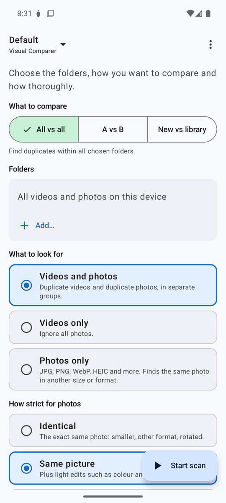
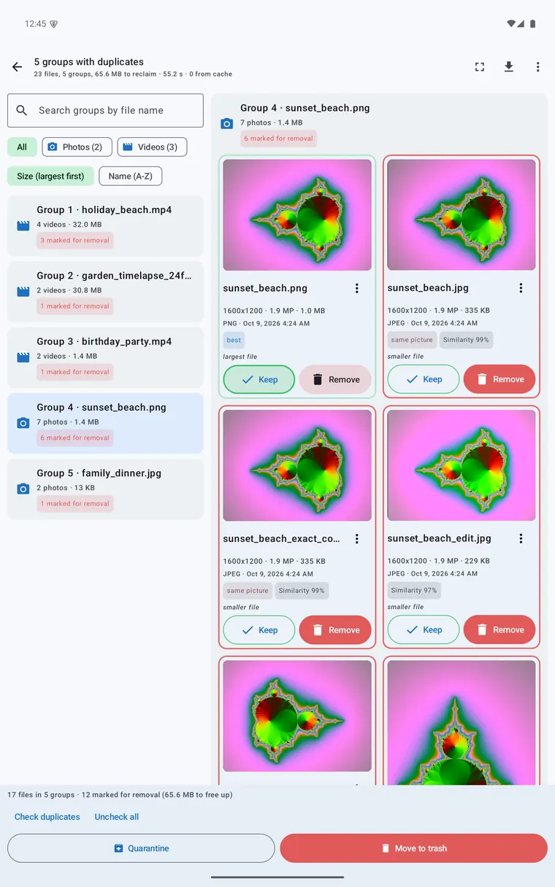
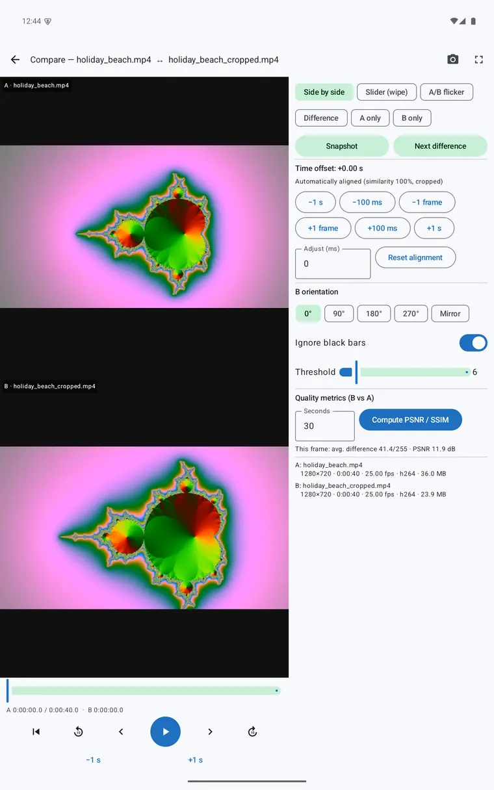
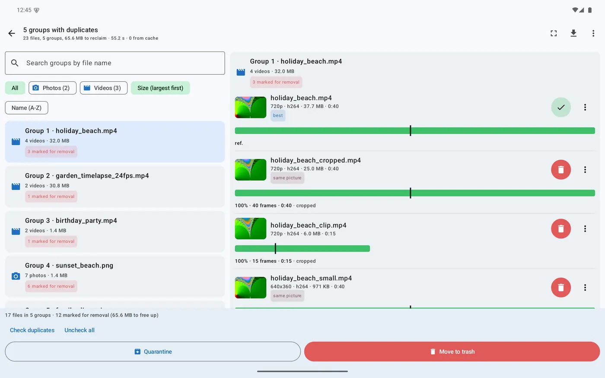
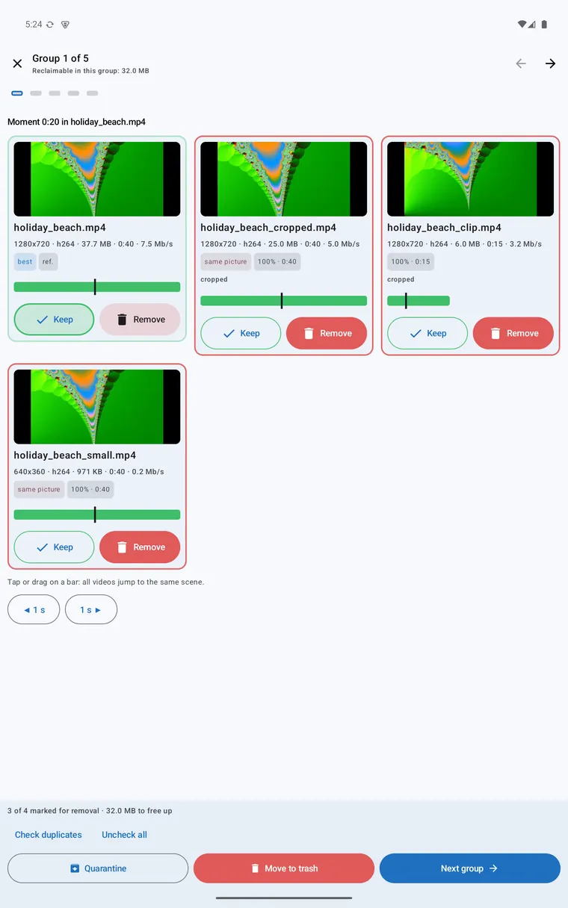
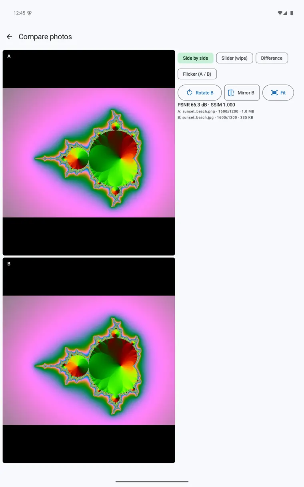
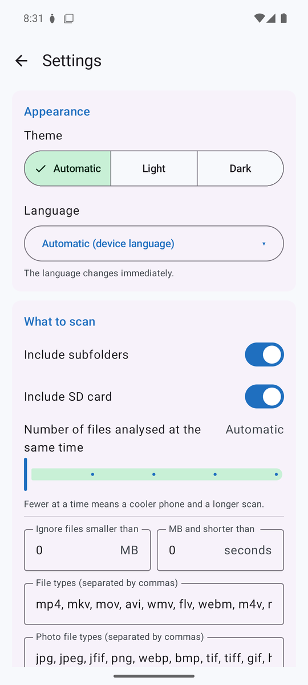
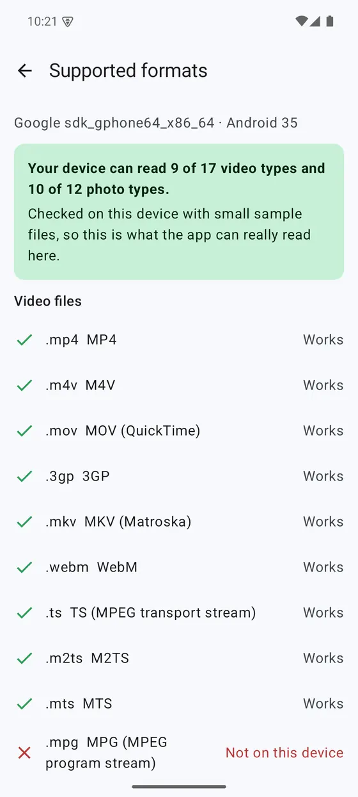

# Visual Comparer Mobile (Android)

**Find duplicate photos and videos on your phone or tablet by what you see, not by their name.**

The same idea as Visual Comparer for Windows: it spots copies that were resized, re-saved, re-encoded, rotated or cropped, lets you compare them side by side and cleans up safely. Built for the big screen of a tablet, and works on phones too. Everything is analysed on your device: no account, no telemetry, nothing is uploaded, and the app does not even have the internet permission.

> 🖥️ **Looking for Windows?** The desktop program is **[VisualComparer](https://github.com/ericbruggema/VisualComparer)**: the same engine, ffmpeg for every format and an installer or portable zip.

  
  
  

| | |
|---|---|
| **Latest version** | 1.0.0 (free edition) |
| **Needs** | Android 11 (API 30) or newer. A tablet is best; phones work too |
| **Download** | [Releases](https://github.com/ericbruggema/VisualComparerMobile/releases/latest): `VisualComparerMobile-<version>.apk` |
| **Free edition limit** | up to **500 videos** and **2,500 photos** per scan |
| **Languages** | English, Dutch, German (follows the language of the device) |
| **License** | Proprietary freeware, see [LICENSE.txt](LICENSE.txt). The source code is not published |

## Install

This app is installed from this repository, not from the Play Store.

1. On your phone or tablet, open the **[latest release](https://github.com/ericbruggema/VisualComparerMobile/releases/latest)** and download `VisualComparerMobile-<version>.apk` (or download it on a computer and copy it over).
2. Open the file. Android asks you to allow installing apps from this source (your browser or file manager). Allow it for now; you can turn it off again afterwards.
3. *Google Play Protect* may say it does not know the app, because it is not published in the Play Store. If you downloaded it from this page and the fingerprint matches, choose to install anyway. If you are not sure, do not install it.
4. Start the app, read and accept the terms. Allow access to photos and videos, and notifications, so a long scan can show its progress.
5. Pick folders and scan.

Step by step with checks of the file and the signing certificate: **[Installation](docs/installation.md)**.

## What it can do

* **Photos and videos in one scan.** One result list. Photos: smaller, re-saved, rotated, mirrored or lightly edited copies. Videos: re-encodes, other resolution or container, clips, crops and speed changes.
* **See which part matches.** A bar on a shared timeline shows how much of each video matches the best version. Tap or drag it and every copy jumps to the same scene.
* **Compare in detail.** Side by side, wipe slider, A/B flicker and a difference heat map, with linked zoom, frame stepping, PSNR and SSIM.
* **Clean up safely.** Move files to the trash or a quarantine folder, with an undo log. Android always asks your permission before files are trashed or deleted. A whole group is never removed at once.
* **Know what your device can read.** The app tests your device and shows which video and photo types it can really open.
* **Private.** Everything is analysed on your device. Photos and videos are never uploaded.

## Made for the tablet screen

Tablets have room to show a lot at once, and the app uses it. On a phone you get one pane at a time; on a tablet the layout opens up.

* **Two-pane results**: the list of groups on the left, the selected group with its match bars on the right.
* **Review in three columns**: walk through the groups with the copies side by side, and keep or remove each one.
* **Two-column start and settings**: all options visible without endless scrolling.
* **Comparer with a control panel**: the two files next to a panel with views, zoom, offset and quality scores, in portrait and landscape.

## Screenshots

| Photo group | Review | Photo comparer |
|:---:|:---:|:---:|
|  |  |  |

| Video comparer | Settings | Supported formats |
|:---:|:---:|:---:|
|  |  |  |

The screenshots come from the Android emulator with generated test photos and videos.

## Which formats can your device read?

Android has no ffmpeg, so the app uses the **decoders of your own device**, and these differ per phone, per tablet and per Android version. That is why the app tests it for you: open **About → Check supported formats on this device**. The app tries small sample files of every type it looks for, and asks which video codecs the device decodes and whether it does so in hardware. You see at once what works on your device and what does not.

* **Video file types**: MP4, M4V, MOV, 3GP, MKV, WebM, TS, M2TS, MTS, MPG, MPEG, VOB, AVI, DIVX, WMV, FLV and OGV
* **Video codecs**: H.264, H.265, VP9, VP8, AV1, MPEG-4, H.263 and MPEG-2
* **Photo types**: JPEG, PNG, WebP, GIF, BMP, TIFF, HEIC, HEIF and AVIF

Many phones and tablets cannot open AVI, WMV, FLV, OGV or MPEG program streams. Files of those types cannot be compared on the device; use the Windows version for them. More in **[Supported formats](docs/formats.md)**.

## Documentation

| Guide | What is in it |
|---|---|
| [Installation](docs/installation.md) | Installing the APK, permissions, checking the file and the certificate, updating, removing |
| [Getting started](docs/getting-started.md) | The first scan, step by step |
| [Photos and videos](docs/photos-and-videos.md) | Strictness levels, accuracy profiles, what is found and what is not |
| [Results and clean-up](docs/results-and-cleanup.md) | Reading groups, comparing, review, trash and quarantine, undo, export |
| [Settings](docs/settings.md) | Every setting, libraries, battery and cache |
| [Supported formats](docs/formats.md) | What your device can read and why |
| [Android compared with Windows](docs/android-vs-windows.md) | What the two versions share and where they differ |
| [FAQ and troubleshooting](docs/faq.md) | Short answers to the questions people ask most |

## Android compared with Windows

| Feature | Windows | Android |
|---|:---:|:---:|
| Duplicate photos and videos in one scan | ✓ | ✓ |
| Match bars on a shared timeline | ✓ | ✓ |
| Side by side, wipe slider, flicker, difference view | ✓ | ✓ |
| PSNR and SSIM | ✓ | ✓ |
| VMAF score | ✓ | not on Android |
| NVIDIA CUDA and GPU alignment | ✓ optional | not on Android |
| Quarantine and undo log | ✓ | ✓ |
| Trash or delete | Recycle Bin | Trash, with system consent each time |
| Supported formats | everything the bundled ffmpeg reads | what your device can decode, tested in the app |
| Installer / portable | ✓ | APK |

## Free edition

This release is the **free edition**: a scan processes up to **500 videos** and **2,500 photos** (the first files in the order of your folders; photos and videos have their own limit). Everything else works without restrictions. If a scan is cut short, the app tells you how many files were skipped. Later versions may be offered in other editions; the terms are published with each release.

## Good to know

* **This is a first release.** It has been tested on an emulator and a limited number of devices, so the speed on your device depends on the device and the number of files.
* **Large scans are best done while charging.** The app runs as a foreground service with a progress notification, and you can choose to scan only while charging.
* **Always keep a backup** of photos and videos you cannot lose. You decide what is removed, and you are responsible for it. See [LICENSE.txt](LICENSE.txt); the same terms are shown in the app on first start.

## Support and feedback

* **Bugs and questions**: open an [issue](https://github.com/ericbruggema/VisualComparerMobile/issues). Please say which version and which device you use, what you did and what you expected. Do not attach photos or videos you want to keep private.
* There is no guaranteed support or response time.
* **Source code**: the source is closed. This repository only contains documentation, release downloads and an issue tracker.

## Related

* 🖥️ **[VisualComparer](https://github.com/ericbruggema/VisualComparer)**: the Windows version, with the same idea and its own documentation.

© 2026 Eric Bruggema. All rights reserved.
