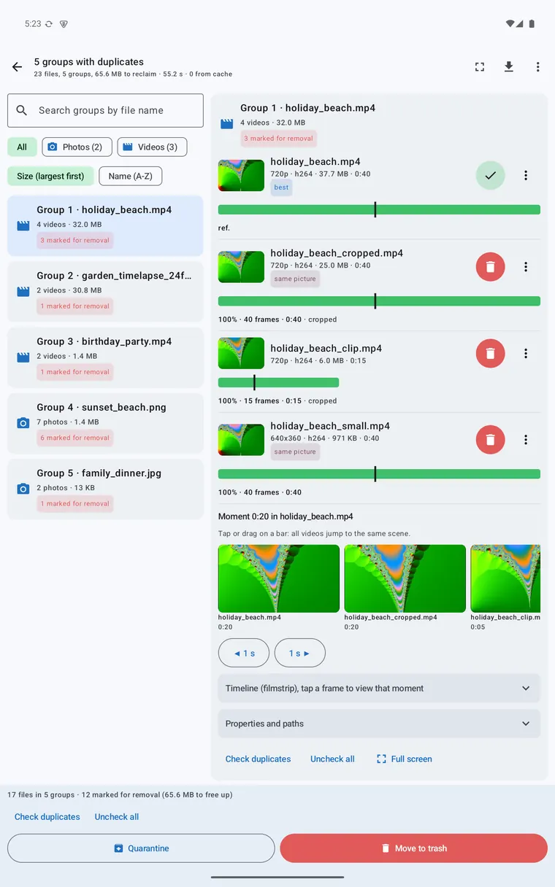

# Results and clean-up

[← Back to the overview](../README.md)

Reading the groups, looking closer, choosing what to keep and removing files safely on Android.

## The result list

* On a **phone**: the list of groups; tap a group to open it. On a **tablet**: the list on the left, the selected group with its details on the right (in landscape too).
* A **group** is one photo or video in several versions. Each copy shows a thumbnail, its properties (dimensions, size, format/codec, duration), the reason it matched and **Keep / Remove** buttons. The best copy is marked *best*.
* Photo groups (📷) show the photos large next to each other. Video groups (🎬) have a **bar on a shared timeline**: a full bar for a full copy, a short bar for a clip. Tap or drag a bar and every copy jumps to the same scene; a film strip shows frames of every copy.
* Above the list: a **search** box, a filter *All / Photos / Videos*, and a sort (largest first, name).
* The summary at the bottom shows how many files are marked for removal and how much space that frees. **Check duplicates** marks all copies except the best in every group; **Uncheck all** clears the marks.
* **Which copy is the best?** *Settings → What to keep?* orders the rules: highest resolution, longest duration, highest bitrate, preferred folder, newest, oldest, preferred codec.

  
  

### Compare again with another sensitivity

On the results screen choose *Compare again* (the sensitivity sheet), set another sensitivity and confirm. The app uses the file list of the previous scan and the fingerprints in the cache: nothing is analysed again. Your marks are kept.

## Look closer

* **Compare** two copies:
  * **Videos**: side by side, wipe slider, A/B flicker, difference heat map, only A, only B; synchronised playback that follows the offset and speed that were found; frame stepping (± frame, ± 1 s, ± 10 s); linked pinch-zoom and pan; manual time offset; *next difference*; a snapshot saved as PNG; rotate or mirror B; **PSNR and SSIM** (VMAF is not available on Android).
  * **Photos**: side by side with linked zoom and pan, wipe slider, difference heat map, flicker, rotate/mirror B.
* **Full screen review**: walk through the groups one by one with the copies side by side (three columns on a tablet); keep or remove each copy with a tap or a swipe, and move on to the next group.
* **Open** a file in your gallery or video player from the menu of a copy.

  
  
  

## Removing files safely

| | Quarantine | Trash |
|---|---|---|
| What it does | Copies the file to a quarantine folder, then deletes the original (with system consent) | Moves the file to Android's trash |
| Restorable | **Yes**, from the app's **Log** (*Undo*) | Through the system's trash (in the Files app or gallery); how long items stay there is decided by Android (typically about 30 days) |
| Where | In the app's own storage (private) by default, or in a folder you choose (SD card, cloud storage) | The system trash |

**Start with quarantine.** Everything stays restorable until you empty it yourself.

* **Android always asks.** Trashing or deleting files needs your consent each time (a system dialog); the app cannot delete anything silently.
* **A whole group is never removed at once**: at least one file is always kept.
* **Protected reference folders** (*Settings → Safety*): files in them are never removed and count as the original.
* **A quick check just before removing**: the file still exists and is unchanged. An extended check (*Settings → Safety*) re-reads both files and compares them again (slow).
* **A log with undo**: every move is recorded; *Undo* restores the file (from quarantine or from the system trash where possible).
* **Cancel** works at any time, also in the middle of a large copy to quarantine.
* Afterwards you see how many files were moved, how much space was freed and any problems.

### Common mistakes

* **Removing from a folder that is synced to the cloud.** A delete may spread to other devices. Use a quarantine folder outside the synced folder, or look at the sync app's settings first.
* **Too loose a setting.** A loose photo level can group burst shots that are not the same. Review those groups carefully.
* **Not checking.** A match percentage is an indication. Compare the copies before you remove one.

## Export

From the results screen you can export the groups as **CSV**, **JSON** or an **HTML report with thumbnails** to a location you pick with Android's file picker, to share or archive the outcome of a scan.

## Broken files

Files that could not be read (damaged, or a type your device cannot decode) are listed in **Broken videos** (menu on the results screen), with checkboxes to send them to quarantine or the trash.

## Saved results

Results are saved **per library**. The app reopens on the results you were looking at, also after the app was closed or the device restarted. When they are loaded again, the files are checked: whatever changed or disappeared drops out, and you see that in the message.
